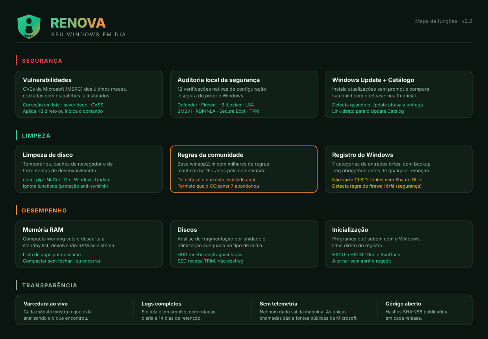
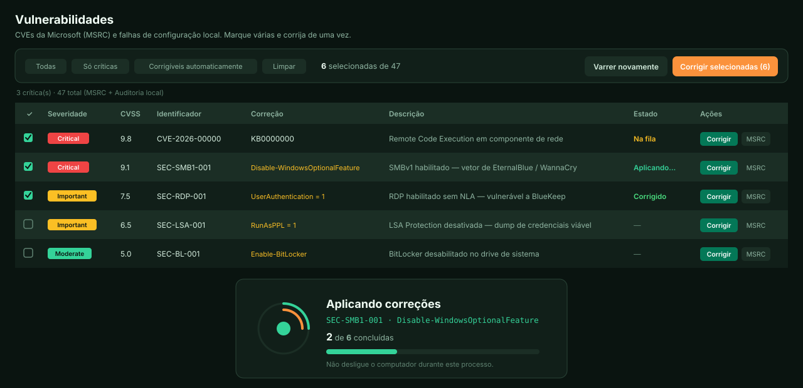

<div align="center">


**Manutenção, desempenho e segurança para Windows**

[](https://github.com/fernandogssilva/Curupira/releases)
[](#requisitos)
[](https://dotnet.microsoft.com/download/dotnet/8.0)
[](LICENSE)

</div>

---

> No folclore brasileiro, o Curupira guarda a mata com os pés virados ao contrário — quem tenta seguir suas pegadas caminha para o lado errado e se perde. É o nome certo para uma ferramenta que protege o que é seu.

---

## O que é

Um painel único que faz o que hoje exige quatro telas diferentes do Windows: verificar vulnerabilidades, instalar atualizações, limpar disco, liberar memória e auditar configurações de segurança.

Sem bundleware, sem telemetria, sem "seu PC está em risco crítico, compre agora".

---

## Mapa de funções



---

## Painel principal

Cada área responde três perguntas: **o que foi encontrado**, **o que aquilo é** e **o que melhora no computador** depois de resolver.


---

## Correção de vulnerabilidades em lote

Marque várias e corrija de uma vez. Cada linha mostra seu próprio estado enquanto a fila avança.



---

## Recursos

| Área | Módulo | O que faz |
|---|---|---|
| **Segurança** | Vulnerabilidades | CVEs da MSRC cruzados com os patches instalados · correção em lote |
| | Auditoria local | 12 verificações: Defender, Firewall, BitLocker, LSA, SMBv1, RDP/NLA, Secure Boot, TPM… |
| | Windows Update | Instalação silenciosa via PSWindowsUpdate |
| | Catálogo Microsoft | Compara sua build com o release-health oficial |
| **Limpeza** | Limpeza de disco | TEMP, caches de navegador e de desenvolvimento, Windows Update, `cleanmgr` |
| | Regras da comunidade | Motor **winapp2.ini** — milhares de regras que o CCleaner 7 abandonou |
| | Registro | 7 categorias de órfãos · **backup `.reg` obrigatório** antes de remover |
| **Desempenho** | Memória RAM | Compacta working sets e descarta a standby list |
| | Apps na memória | Lista por consumo · compactar sem fechar ou encerrar |
| | Discos | Desfragmentação em HDD, TRIM em SSD |
| | Inicialização | Programas que sobem com o Windows |
| **Sistema** | Varredura ao vivo | Cada módulo mostrando o que analisa em tempo real |
| | Logs | Em tela e em arquivo, rotação diária |

📖 **[Documentação completa de cada função](docs/FUNCIONALIDADES.md)**

---

## Instalação

### Opção 1 — Baixar o executável

Baixe o `Curupira.exe` na [página de releases](https://github.com/fernandogssilva/Curupira/releases). É self-contained: **não precisa instalar o .NET**.

Confira o hash antes de executar:

```powershell
Get-FileHash Curupira.exe -Algorithm SHA256
```

### Opção 2 — Instalar com atalhos

```powershell
# PowerShell como Administrador
.\scripts\install-local.ps1
```

Copia para `%ProgramFiles%\Curupira`, cria atalhos no Desktop e no Menu Iniciar, e registra em Adicionar/Remover Programas.

### Opção 3 — Compilar do código

```powershell
git clone https://github.com/fernandogssilva/Curupira.git
cd Curupira
.\scripts\publish.ps1 -SelfContained
```

O executável sai em `src\Curupira\bin\publish\Curupira.exe`.

---

## Requisitos

- Windows 10 20H1+ ou Windows 11 · x64
- Executar como Administrador (o app solicita UAC sozinho)
- PowerShell 5.1+ e Winget (nativos no Windows 11)
- Módulo `PSWindowsUpdate` — instalado na primeira execução

---

## Privacidade

Nenhum dado sai da sua máquina. As únicas chamadas de rede são a fontes públicas:

| Destino | Para quê |
|---|---|
| `api.msrc.microsoft.com` | CVEs publicadas pela Microsoft |
| `learn.microsoft.com` | Build mais recente do Windows |
| `raw.githubusercontent.com` | Base winapp2.ini (opcional) |

Sem analytics, sem crash reports, sem identificador de máquina. Logs ficam apenas em `%LOCALAPPDATA%\Curupira\logs\`.

---

## O que o Curupira deliberadamente não faz

| Não faz | Por quê |
|---|---|
| Limpeza de CLSID em massa, fontes ou Shared DLLs | É onde os "otimizadores" quebram instalações |
| "Secure delete" multi-passe | Em SSD com wear leveling não garante nada |
| Prometer velocidade ao limpar registro | Não existe ganho mensurável — e o app diz isso na tela |
| Telemetria ou bundleware | — |

---

## Estrutura

```
Curupira/
├── Curupira.sln
├── Curupira.bat · Curupira.ps1     launchers com auto-elevação
├── update.bat                       atualizador de 1 clique
│
├── src/Curupira/
│   ├── Services/                    15 serviços (um por módulo)
│   ├── ViewModels/MainViewModel.cs  MVVM
│   ├── Themes/                      claro, escuro e estilos comuns
│   ├── Models/ · Converters/
│   └── Assets/Curupira.ico
│
├── installer/setup.iss              Inno Setup 6
├── scripts/                         publish · install · build-icon
└── docs/
    ├── FUNCIONALIDADES.md
    ├── brand/ · images/
    ├── legal/EULA.md
    ├── security/SECURITY_AUDIT.md
    └── strategy/
```

---

## Aviso

O Curupira executa operações administrativas: instala atualizações, **remove arquivos permanentemente** e altera o registro. Mantenha backups. Leia o [EULA](docs/legal/EULA.md) antes de usar.

O binário ainda **não é assinado**, então o Windows exibe *Fornecedor: Desconhecido* no UAC. Compare o SHA-256 publicado em cada release.

---

<div align="center">

MIT © 2026 [Fernando Silva](https://github.com/fernandogssilva) · DataSec

</div>
