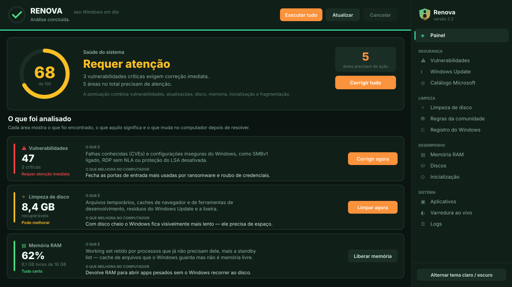

<div align="center">


**Manutenção, desempenho e segurança para Windows — num painel só.**

[](https://github.com/fernandogssilva/Renova/releases)
[](LICENSE)
[](#requisitos)
[](https://dotnet.microsoft.com/)

</div>

---

O **Renova** devolve ao seu computador o fôlego de quando ele era novo: atualizado, limpo, leve e protegido. Tudo isso sem complicação, sem susto e sem precisar entender de informática.

O Renova reúne num único painel o que hoje exige quatro telas diferentes do Windows — Windows Update, atualização de aplicativos, limpeza de disco, verificação de vulnerabilidades e diagnóstico de configuração insegura. Sem bundleware, sem telemetria, sem popup de upsell.

---

## O que ele faz


📖 **[Documentação completa das funcionalidades →](docs/FUNCIONALIDADES.md)**

---

## O painel



Cada área responde três perguntas, em vez de mostrar só um número:

1. **O que foi encontrado**
2. **O que é** — a explicação técnica
3. **O que melhora no computador** — o benefício concreto

---

## Destaques

### 🛡️ Vulnerabilidades com correção em lote
CVEs oficiais da Microsoft (MSRC) somadas a **12 verificações locais** de configuração insegura — SMBv1 ligado, RDP sem NLA, LSA Protection desativada, BitLocker ausente. Marque várias e corrija de uma vez, com estado visual por linha.

### 🗄️ Regras da comunidade (winapp2)
Suporte à base [winapp2.ini](https://github.com/MoscaDotTo/Winapp2) — milhares de regras mantidas há mais de 15 anos, cobrindo aplicativos que nenhum limpador genérico conhece. **Formato que o CCleaner 7 abandonou.** O Renova detecta primeiro o que está instalado, e só então mede.

### 🔑 Registro com backup obrigatório
7 categorias de entradas órfãs. Todo backup `.reg` é feito **antes** da remoção — se o export falhar, a remoção é abortada. Restaurar é duplo clique.

### 🧠 Memória por aplicativo
Veja quem está consumindo RAM, agrupado por aplicativo. **Compactar** devolve memória sem fechar; **Encerrar** fecha de vez. Processos críticos do Windows vêm bloqueados.

### ⚙️ Pré-requisitos automáticos
Na instalação, verifica todos os cmdlets necessários e instala o que for instalável. O que depender da edição do Windows, ele avisa e desliga a função — em vez de falhar em silêncio depois.

---

## Honestidade técnica

O app declara na própria interface o que **não** funciona como prometido por aí:

> **Limpar registro não acelera o Windows.** O registro tem milhões de chaves indexadas em memória — remover algumas centenas não muda tempo de boot nem uso de RAM. O ganho real é higiene e, no caso das regras de firewall órfãs, segurança.

> **Liberar RAM não "cria" memória.** O ganho é perceptível depois de fechar aplicativos pesados. Como efeito colateral, o cache de arquivos esfria — por isso não vale executar de minuto em minuto.

Por isso o Renova **não** varre CLSID em massa, fontes nem Shared DLLs. É exatamente onde os otimizadores de mercado quebram instalações.

---

## Instalação

### Instalador (recomendado)

Baixe o `Renova-Setup-<versão>.exe` na [página de releases](https://github.com/fernandogssilva/Renova/releases), dê dois cliques e siga o assistente:

**Boas-vindas → Licença → Pasta de destino → Opções → Instalar**

Ele instala em `%ProgramFiles%\Renova`, cria os atalhos no menu Iniciar e na área de trabalho e aparece em *Adicionar/Remover Programas*. Não precisa ter o .NET instalado. Se encontrar uma instalação antiga do **Curupira** (nome anterior do produto), o instalador a remove e preserva logs e backups do registro.

### Executável avulso

Prefere sem instalar? Pegue o `Renova.exe` na mesma página e execute. Ele solicita elevação sozinho.

Cada release traz o hash **SHA-256** para você conferir a integridade:

```powershell
Get-FileHash .\Renova-Setup-3.0.0.exe -Algorithm SHA256
Get-FileHash .\Renova.exe -Algorithm SHA256
```

### Gerar o instalador

```powershell
# Requer .NET 10 SDK e Inno Setup 6 (winget install JRSoftware.InnoSetup)
.\scripts\build-installer.ps1
```

O `Renova-Setup-<versão>.exe` é gerado na **raiz do projeto**, junto do `.sha256`.

> O binário ainda **não é assinado**, então o Windows exibe *Fornecedor: Desconhecido* no UAC. Certificado de code signing está no roadmap.

### Instalar com atalhos e registro

```powershell
# PowerShell como Administrador
.\scripts\install-local.ps1
```

Copia para `%ProgramFiles%\Renova`, cria atalhos no desktop e no menu Iniciar, registra em Adicionar/Remover Programas e **verifica e instala os pré-requisitos**.

### Compilar do código-fonte

```powershell
git clone https://github.com/fernandogssilva/Renova.git
cd Renova
dotnet restore
.\scripts\publish.ps1 -SelfContained
```

---

## Como rodar

| Forma | Arquivo |
|---|---|
| Duplo clique | `Renova.bat` |
| PowerShell | `.\Renova.ps1` (use `-Build` para compilar antes) |
| Executável | `Renova.exe` |

---

## Requisitos

- **Windows 10 20H1+** ou **Windows 11**, x64
- **PowerShell 5.1** (nativo no Windows)
- **Privilégio de administrador** — solicitado automaticamente
- **Winget** para atualizar aplicativos (nativo no Windows 11; via Microsoft Store no Windows 10)
- **PSWindowsUpdate** — instalado automaticamente, em versão fixada e auditada

Se publicar com `-SelfContained`, nenhum runtime extra é necessário.

---

## Estrutura

```
Renova/
├── Renova.sln
├── Renova.bat · Renova.ps1        launchers com auto-elevação
├── update.bat                          atualizador de 1 clique
├── src/Renova/
│   ├── Services/                       16 serviços
│   ├── ViewModels/MainViewModel.cs     MVVM
│   ├── Themes/                         paleta clara e escura
│   └── MainWindow.xaml                 14 seções
├── installer/setup.iss                 instalador (Inno Setup 6)
├── scripts/                            build-installer · publish · install · build-icon
└── docs/
    ├── FUNCIONALIDADES.md              documentação completa
    ├── brand/                          logo e ícone
    ├── images/                         diagramas
    ├── legal/EULA.md
    └── security/SECURITY_AUDIT.md
```

---

## Privacidade

Nenhum dado sai da sua máquina. As únicas chamadas de rede são para fontes públicas oficiais:

| Destino | Para quê |
|---|---|
| `api.msrc.microsoft.com` | CVEs da Microsoft |
| `learn.microsoft.com` | Release-health do Windows |
| `raw.githubusercontent.com` | Base winapp2.ini |
| `www.powershellgallery.com` | Módulo PSWindowsUpdate |
| `github.com` | Só se você reportar um problema: o navegador abre um issue para você revisar e publicar |

Sem telemetria, sem analytics, sem crash reports. Os logs ficam só no seu disco, e os caminhos são sanitizados (`C:\Users\<nome>\` vira `C:\Users\%USER%\`) para você poder compartilhá-los sem se expor.

---

## Licença

MIT — veja [LICENSE](LICENSE). Uso do software está sujeito ao [EULA](docs/legal/EULA.md).

<div align="center">

**Renova** · seu Windows em dia

</div>
