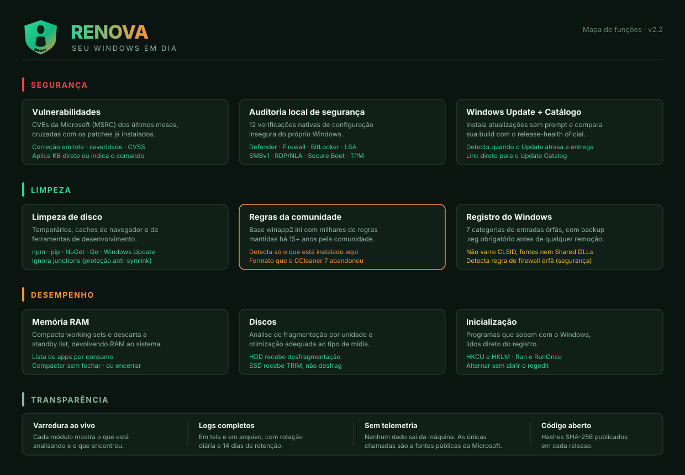

# Funcionalidades do Curupira

Documento de referência do que a plataforma faz, módulo a módulo.



---

## Índice

- [Segurança](#segurança)
- [Limpeza](#limpeza)
- [Desempenho](#desempenho)
- [Sistema e transparência](#sistema-e-transparência)
- [O que o Curupira deliberadamente NÃO faz](#o-que-o-curupira-deliberadamente-não-faz)
- [Resumo técnico](#resumo-técnico)

---

## Segurança

### 1. Vulnerabilidades (CVEs)

Consulta a **MSRC CVRF API** da Microsoft (`api.msrc.microsoft.com/cvrf/v3.0`) e cruza os CVEs publicados com os patches já instalados na máquina.

| Recurso | Detalhe |
|---|---|
| Fonte | API oficial da Microsoft, últimos 3 meses |
| Filtro por produto | Só mostra CVEs do seu Windows (10 ou 11), lido do registro |
| Dados por CVE | Severidade, CVSS Base Score, KB que corrige, data de publicação |
| Deduplicação | Cruza com `Get-HotFix` — não mostra o que já está aplicado |
| Cache | 30 minutos em memória, evita re-download em varreduras seguidas |

**Correção em lote:** marque várias e aplique de uma vez. Cada linha percorre os estados `Na fila → Aplicando → Corrigido / Falhou / Manual`, com cor própria.

Seleção rápida: **Todas** · **Só críticas** · **Corrigíveis automaticamente** · **Limpar**.

O app distingue dois tipos de correção:

- **KB real** (`KB5039212`) — instala sozinho via `Get-WindowsUpdate -KBArticleID`
- **Configuração local** (`Disable-WindowsOptionalFeature ...`) — marcada como *Manual*, exibindo o comando exato para você executar

Essa distinção existe para o app nunca reportar como corrigido algo que não corrigiu.

### 2. Auditoria local de segurança

12 verificações nativas de configuração insegura do próprio Windows — o tipo de coisa que scanners comerciais reportam:

| # | Verificação | O que detecta |
|---|---|---|
| 1 | Windows Defender | Antivírus desligado, proteção em tempo real off, Tamper Protection off, assinaturas com mais de 7 dias |
| 2 | Firewall | Perfis Domain, Private ou Public desativados |
| 3 | BitLocker | Drive de sistema sem criptografia |
| 4 | LSA Protection | `RunAsPPL` desativado — permite dump de credenciais (Mimikatz) |
| 5 | Credential Guard | VBS inativo |
| 6 | SMBv1 | Habilitado — vetor de EternalBlue e WannaCry |
| 7 | NoLmHash | Hashes LM não bloqueados |
| 8 | RDP + NLA | RDP exposto sem Network Level Authentication (BlueKeep) |
| 9 | Contas | AutoLogon com senha em texto claro, Guest habilitada, senhas em branco permitidas |
| 10 | Secure Boot + TPM | Desativados — bootkits viáveis |
| 11 | PowerShell v2 | Instalado — permite bypass de script-block logging |
| 12 | Portas expostas | 135, 139, 445, 3389, 5985, 5986 escutando em `0.0.0.0` |

**Integração opcional com Sysinternals.** Se `sigcheck.exe` e `autorunsc.exe` estiverem no PATH ou em `C:\Sysinternals`, o Curupira também verifica binários sem assinatura em `System32` e faz enumeração completa de persistência.

### 3. Windows Update

Instalação sem prompts via `PSWindowsUpdate` (versão fixada em `2.2.1.5` para evitar ataque de supply chain).

### 4. Catálogo Microsoft

Compara a build instalada com a última publicada no **release-health oficial** da Microsoft. Detecta quando o Windows Update atrasa a entrega — o que acontece com frequência e passa despercebido.

---

## Limpeza

### 5. Limpeza de disco

Alvos mapeados automaticamente: TEMP do usuário e do Windows, Prefetch, downloads do Windows Update, `Windows.old`, Delivery Optimization, caches de Brave, Chrome e Edge, e caches de desenvolvimento — npm, pip, NuGet, Go.

Depois executa `cleanmgr /sagerun` com 26 presets ativados.

**Proteção anti-symlink:** a varredura ignora reparse points. Sem isso, uma junction plantada dentro de `%TEMP%` apontando para `Documentos` faria o app apagar seus arquivos.

### 6. Regras da comunidade (winapp2.ini)

O recurso que dá profundidade real ao módulo de limpeza.

`winapp2.ini` é uma base comunitária com **milhares de regras** de limpeza, mantida há mais de 15 anos. Cobre aplicativos específicos que nenhum limpador genérico conhece. **O CCleaner 7 abandonou esse formato.**

Como funciona, na ordem:

```
1. Baixa a base oficial (MoscaDotTo/Winapp2)
2. DETECTA quais regras se aplicam a esta máquina
     Detect=HKCU\Software\...      a chave existe?
     DetectFile=%LocalAppData%\... o caminho existe?
   → milhares de regras viram algumas dezenas relevantes
3. MEDE o espaço só das que passaram (em paralelo)
4. Você escolhe o que limpar
```

A etapa 2 é o que torna isso viável — sem ela, seriam milhares de varreduras de disco inúteis.

Suporta expansão de 22 variáveis (`%LocalAppData%`, `%CommonAppData%`, `%WinDir%`...), curingas no meio do caminho (`User Data\*\Cache`) e as flags `RECURSE` e `REMOVESELF`.

### 7. Registro do Windows

> **Limpar registro não acelera o Windows.** O registro tem milhões de chaves e fica indexado em memória — remover algumas centenas não muda tempo de boot nem uso de RAM. O app diz isso na própria interface.

O valor real aqui é **higiene** e, num caso específico, **segurança**.

7 categorias analisadas em paralelo:

| Categoria | O que detecta | Relevância |
|---|---|---|
| Caminhos de aplicativo | App Paths apontando para `.exe` inexistente | Resíduo |
| Inicialização quebrada | Run/RunOnce chamando arquivo que sumiu | Desperdício |
| Programa desinstalado | Entradas fantasma em Adicionar/Remover | Resíduo |
| **Regra de firewall órfã** | **Libera `.exe` que não existe mais** | **Segurança** |
| Histórico de uso | RunMRU e TypedPaths | Privacidade |
| Cache de nomes | MUICache com referências mortas | Resíduo |
| Extensão sem destino | `.ext` apontando para ProgID não registrado | Resíduo |

**Por que a regra de firewall órfã importa:** se o Windows tem uma regra liberando `C:\Games\antigo\jogo.exe` e esse arquivo sumiu, qualquer programa instalado exatamente naquele caminho **herda a permissão de rede** sem passar por você.

**Backup obrigatório.** Antes de qualquer remoção, o app exporta as chaves afetadas para um `.reg` em `%LOCALAPPDATA%\Curupira\registry-backups\`. Se o export falhar, **a remoção é abortada**. Restaurar é duplo clique no arquivo.

---

## Desempenho

### 8. Memória RAM

Duas operações distintas:

1. **Compactar working sets** — `EmptyWorkingSet` em cada processo, devolvendo páginas retidas
2. **Descartar a standby list** — `NtSetSystemInformation` com `SeProfileSingleProcessPrivilege`, convertendo cache de arquivos em memória livre de verdade

> Isso **não cria RAM**. O ganho é perceptível depois de fechar aplicativos pesados ou antes de abrir algo que precisa de bastante memória. O efeito colateral é o cache de arquivos esfriar — por isso não vale executar de minuto em minuto.

### 9. Aplicativos consumindo memória

Top 25 aplicativos por consumo, **agrupados por nome** — navegadores abrem dezenas de processos e apareceriam como dezenas de linhas.

| Ação | O que faz |
|---|---|
| **Compactar** | `EmptyWorkingSet` só naquele app — devolve memória **sem fechar** |
| **Encerrar** | `CloseMainWindow()` primeiro, permitindo salvar; `Kill` após 2,5 s |

Processos críticos do Windows (`csrss`, `lsass`, `wininit`, `services`, `dwm`, `explorer`) aparecem com o botão desabilitado e marcados como *Componente do Windows*. Encerrar qualquer um deles derruba a sessão ou causa tela azul.

### 10. Discos

`Optimize-Volume -Analyze` por unidade. **HDD** recebe desfragmentação; **SSD** recebe TRIM — desfragmentar SSD só consome ciclos de escrita à toa.

### 11. Inicialização

Lê `HKCU` e `HKLM`, chaves `Run` e `RunOnce`, cruzando com `StartupApproved` para saber o que está realmente ativo. Permite alternar sem abrir o `regedit`.

---

## Sistema e transparência

### 12. Painel principal

**Pontuação de saúde 0-100** num anel colorido. Pondera vulnerabilidades críticas (peso maior), atualizações de segurança, aplicativos desatualizados, disco recuperável, uso de RAM, apps de inicialização, fragmentação e defasagem de build.

Abaixo, 8 cards — cada um respondendo três perguntas:

- **O que foi encontrado** — o número e a severidade
- **O que é** — a explicação técnica
- **O que melhora no computador** — o benefício concreto

### 13. Varredura ao vivo

Cada módulo mostrando, em tempo real: estado, contador de itens, barra de progresso, atividade atual, último item encontrado e a ação sugerida ao concluir.

### 14. Logs

Em tela com auto-scroll e em arquivo (`Serilog`), com rotação diária e 14 dias de retenção, em `%LOCALAPPDATA%\Curupira\logs\`.

### 15. Temas

Claro e escuro, com paleta recalculada em cada modo para manter contraste AA — não é o mesmo verde apenas clareado. A barra de título da janela acompanha o tema via DWM.

---

## O que o Curupira deliberadamente NÃO faz

Tão importante quanto a lista de recursos:

| Não faz | Por quê |
|---|---|
| Limpeza de CLSID em massa | É onde os "otimizadores" de mercado quebram instalações |
| Remoção de fontes ou Shared DLLs | Mesmo motivo |
| "Secure delete" multi-passe | Em SSD com wear leveling não garante nada — é teatro |
| Prometer ganho de desempenho ao limpar registro | Não existe ganho mensurável |
| Telemetria, analytics ou crash reports | Nenhum dado sai da máquina |
| Bundleware, upsell ou scareware | Sem "seu PC está em risco crítico, compre agora" |

As únicas chamadas de rede são a fontes públicas da Microsoft (`learn.microsoft.com`, `api.msrc.microsoft.com`) e ao repositório do winapp2 — todas documentadas e todas anônimas.

---

## Resumo técnico

| Item | Valor |
|---|---|
| Plataforma | WPF · .NET 8 · C# 12 |
| Arquitetura | MVVM com CommunityToolkit.Mvvm |
| Distribuição | Single-file self-contained (~75 MB), sem runtime externo |
| Requisito | Windows 10 20H1+ ou Windows 11, x64 |
| Elevação | Manifesto `requireAdministrator` — UAC único no início |
| Paralelismo | `MaxDegreeOfParallelism = ProcessorCount - 1` (deixa um núcleo para a UI) |
| Cancelamento | Respeitado a cada alvo — cancelar responde em menos de 1 s |
| Segurança do próprio app | Scripts PowerShell em pasta com ACL restrita a Administrators + SYSTEM; validação regex antes de qualquer interpolação em shell |
| Integridade | SHA-256 publicado em cada release |

---

© 2026 DataSec
